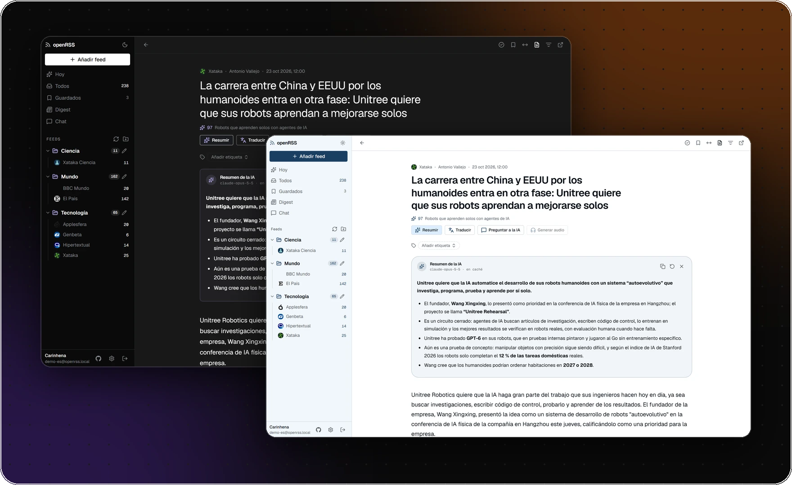
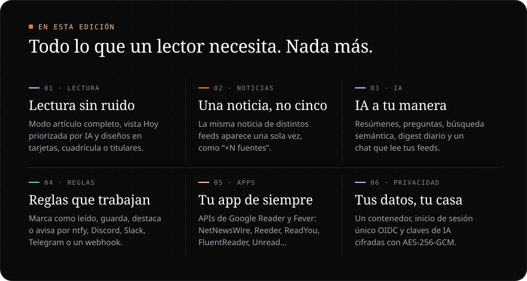
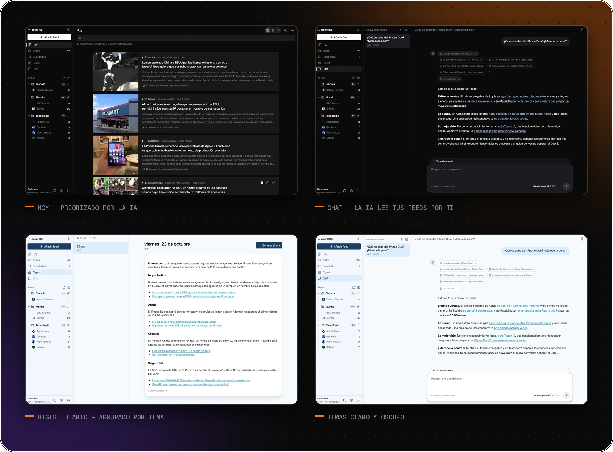
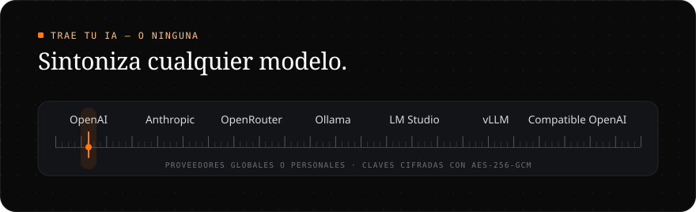

<div align="center">



<br>

<sub>[English](README.md) · [Português](README.pt-BR.md) · **Español**</sub>

<br>

<a href="https://github.com/CariSoftwareBR/openRSS/actions/workflows/ci.yml"></a>
<a href="LICENSE"></a>
<a href="https://github.com/CariSoftwareBR/openRSS/pkgs/container/openrss"></a>
<a href="https://buymeacoffee.com/pcarinhena"></a>

</div>

<br>



<br>
<br>



<br>
<br>



<br>
<br>

<h3 align="center">Un día en tus feeds</h3>



<details>
<summary><b>Todo lo que hace</b></summary>

<br>

**Lectura** — Hoy (priorizado por la IA), Todos, Guardados, carpetas y feeds individuales · tarjetas, cuadrícula o solo titulares · modo artículo completo (Readability) · búsqueda instantánea · noticias repetidas agrupadas como “+N fuentes” (leer una marca las demás) · PWA instalable con lectura offline · atajos de teclado: <kbd>j</kbd> <kbd>k</kbd> navegar · <kbd>o</kbd> abrir · <kbd>m</kbd> marcar leído · <kbd>s</kbd> guardar · <kbd>Shift</kbd>+<kbd>A</kbd> marcar todos · <kbd>/</kbd> buscar

**Feeds** — descubrimiento automático desde la URL del sitio (RSS, Atom, RDF) · actualización en segundo plano con ETag/Last-Modified y backoff · importar y exportar OPML · leer más tarde desde el botón en Guardados, un bookmarklet o el menú Compartir del móvil · etiquetas · reglas automáticas por título, contenido, autor, URL o nota de la IA: marcar como leído, guardar, destacar o avisar por ntfy, Discord, Slack, Telegram o webhook · salud de los feeds (con errores, parados, poco leídos o demasiado activos) con limpieza en lote · retención configurable

**IA** — resúmenes en streaming, con caché · preguntas sobre el artículo en el lector · traducción · lectura en voz alta · búsqueda semántica con embeddings · digest diario, bajo demanda o por correo · un chat que busca y lee tus feeds · nota de prioridad de 0 a 100 según tus intereses

**Personas** — correo y contraseña o inicio de sesión único OIDC (Authentik, Authelia, Keycloak…) · la primera cuenta es la de administrador · registro abierto o cerrado · contraseñas de aplicación para NetNewsWire, Reeder, ReadYou, FluentReader, Unread… mediante las APIs de Google Reader y Fever · temas claro y oscuro ([design system](docs/design/))

**Funciona con** — un contenedor · SQLite (hasta ~5 usuarios simultáneos) o PostgreSQL · Next.js 16, React 19, Prisma 7, Better Auth y AI SDK 7

</details>

<br>
<br>

<h3 align="center">Instálalo con una frase</h3>



```text
Instala openRSS: https://github.com/CariSoftwareBR/openRSS
```

<sub>**Agentes de IA:** seguid [INSTALL.md](INSTALL.md#install) al pie de la letra, de principio a fin. Usad Docker con SQLite salvo que el usuario pida PostgreSQL, y pasad el navegador al usuario solo para crear la cuenta de administrador.</sub>

<details>
<summary><b>¿Prefieres escribirlo tú?</b> Tres comandos con Docker</summary>

<br>

```bash
git clone https://github.com/CariSoftwareBR/openRSS.git && cd openRSS
docker compose up -d --build
docker compose logs openrss | grep -i token   # token de instalación para la primera visita
```

Abre **http://localhost:8285/setup**, pega el token, elige **SQLite** y crea tu cuenta de administrador. PostgreSQL, la imagen lista en GHCR, la configuración y la solución de problemas están en la [guía de instalación](INSTALL.md) (en inglés).

</details>

<br>



<br>
<br>

<div align="center">

**Añade un feed. Lee lo que importa. Lo demás puede esperar.**

<sub>[Guía de instalación](INSTALL.md) · [Configuración](INSTALL.md#configuration) · [Desarrollo](docs/DEVELOPMENT.md) · [Design system](docs/design/) · [Seguridad](SECURITY.md) · [Apache 2.0](LICENSE) · Hecho por [CariSoftwareBR](https://github.com/CariSoftwareBR)</sub>

</div>
