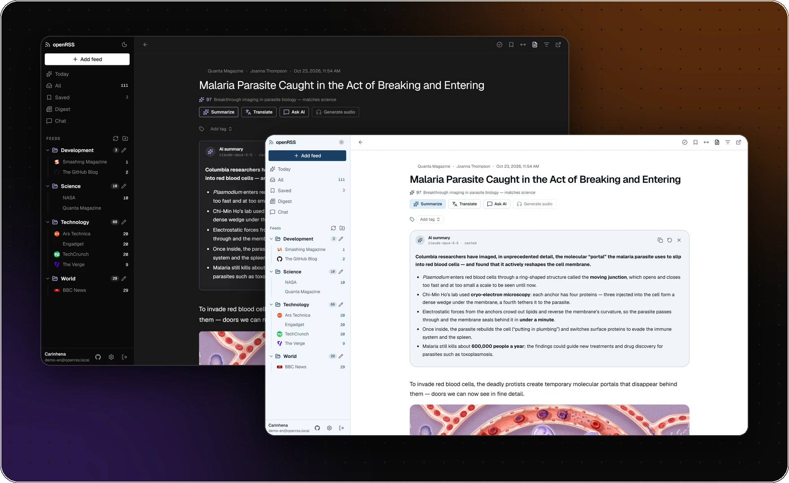
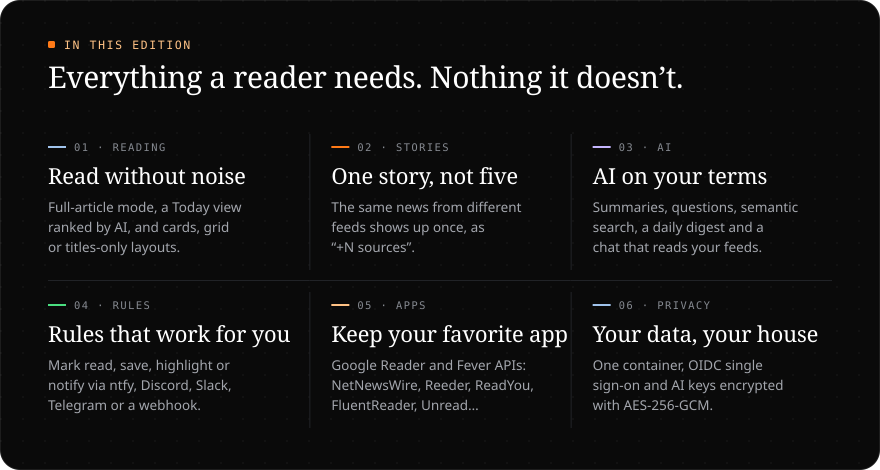
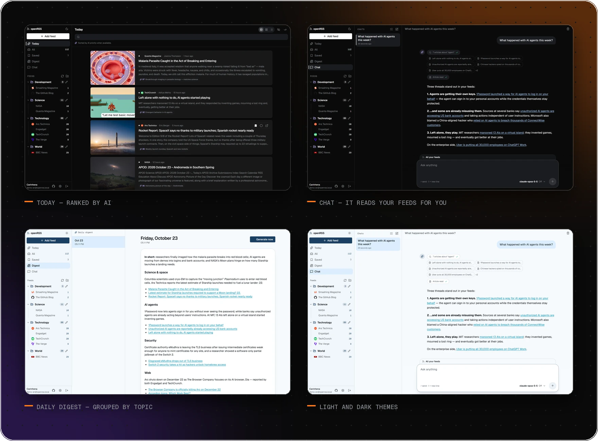
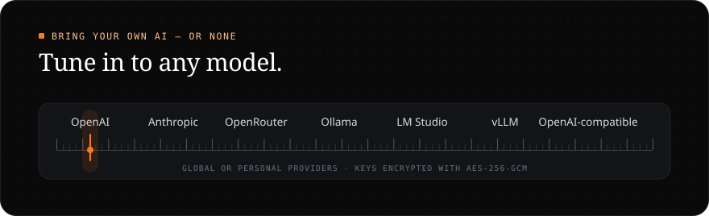

<div align="center">



<br>

<sub>**English** · [Português](README.pt-BR.md) · [Español](README.es.md)</sub>

<br>

<a href="https://github.com/CariSoftwareBR/openRSS/actions/workflows/ci.yml"></a>
<a href="LICENSE"></a>
<a href="https://github.com/CariSoftwareBR/openRSS/pkgs/container/openrss"></a>
<a href="https://buymeacoffee.com/pcarinhena"></a>

</div>

<br>



<br>
<br>



<br>
<br>



<br>
<br>

<h3 align="center">A day in your feeds</h3>



<details>
<summary><b>Everything it does</b></summary>

<br>

**Reading** — Today (ranked by AI), All, Saved, folders and single feeds · cards, grid or titles-only · full-article mode (Readability) · instant search · duplicate stories grouped as “+N sources” (reading one marks the rest) · installable PWA with offline reading · keyboard shortcuts: <kbd>j</kbd> <kbd>k</kbd> navigate · <kbd>o</kbd> open · <kbd>m</kbd> mark read · <kbd>s</kbd> save · <kbd>Shift</kbd>+<kbd>A</kbd> mark all · <kbd>/</kbd> search

**Feeds** — auto-discovery from a site URL (RSS, Atom, RDF) · background refresh with ETag/Last-Modified and backoff · OPML import and export · read later from the Saved button, a bookmarklet or the phone’s share menu · tags · automatic rules on title, content, author, URL or AI score: mark read, save, highlight or notify via ntfy, Discord, Slack, Telegram or webhook · feed health (failing, stale, unread or noisy feeds) with bulk cleanup · configurable retention

**AI** — streamed, cached summaries · questions about the article in the reader · translation · text-to-speech · semantic search with embeddings · daily digest, on demand or by email · a chat that searches and reads your feeds · priority score from 0 to 100 based on your interests

**People** — email and password or OIDC single sign-on (Authentik, Authelia, Keycloak…) · the first account becomes admin · open or closed registration · app passwords for NetNewsWire, Reeder, ReadYou, FluentReader, Unread… via the Google Reader and Fever APIs · light and dark themes ([design system](docs/design/))

**Runs on** — one container · SQLite (up to ~5 concurrent users) or PostgreSQL · Next.js 16, React 19, Prisma 7, Better Auth and AI SDK 7

</details>

<br>
<br>

<h3 align="center">Install it with one sentence</h3>



```text
Install openRSS: https://github.com/CariSoftwareBR/openRSS
```

<sub>**AI agents:** follow [INSTALL.md](INSTALL.md#install) exactly, top to bottom. Use Docker with SQLite unless the user asks for PostgreSQL, and hand the browser to the user only to create the admin account.</sub>

<details>
<summary><b>Rather type it yourself?</b> Three commands with Docker</summary>

<br>

```bash
git clone https://github.com/CariSoftwareBR/openRSS.git && cd openRSS
docker compose up -d --build
docker compose logs openrss | grep -i token   # setup token for the first visit
```

Open **http://localhost:8285/setup**, paste the token, pick **SQLite** and create your admin account. PostgreSQL, the prebuilt GHCR image, configuration and troubleshooting are in the [install guide](INSTALL.md).

</details>

<br>



<br>
<br>

<div align="center">

**Add a feed. Read what matters. Let the rest wait.**

<sub>[Install guide](INSTALL.md) · [Configuration](INSTALL.md#configuration) · [Development](docs/DEVELOPMENT.md) · [Design system](docs/design/) · [Security](SECURITY.md) · [Apache 2.0](LICENSE) · Made by [CariSoftwareBR](https://github.com/CariSoftwareBR)</sub>

</div>
