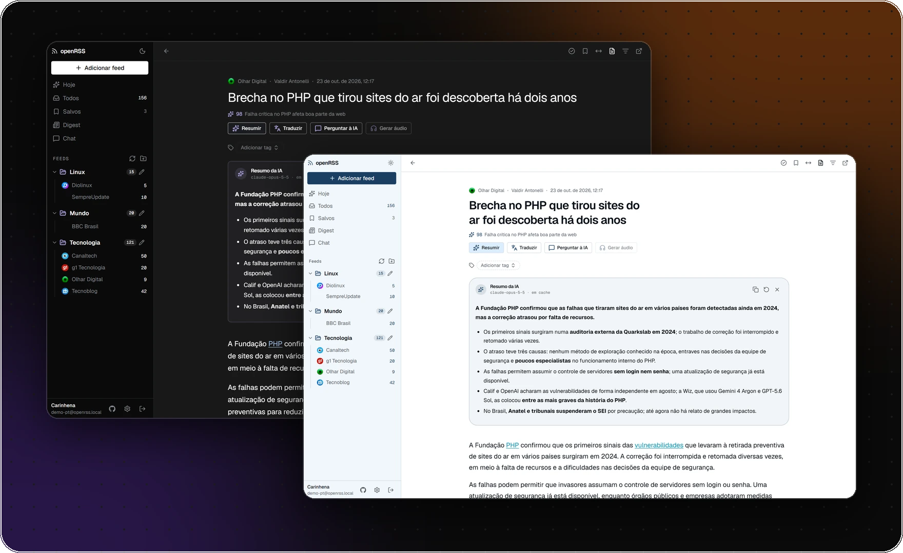
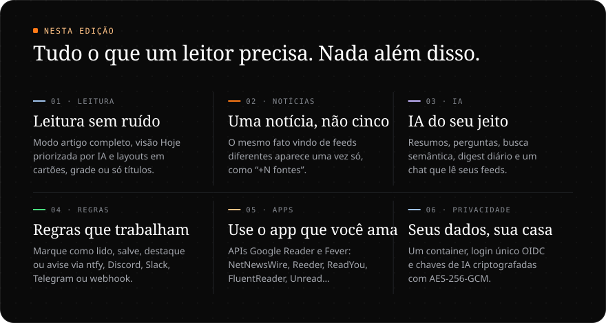
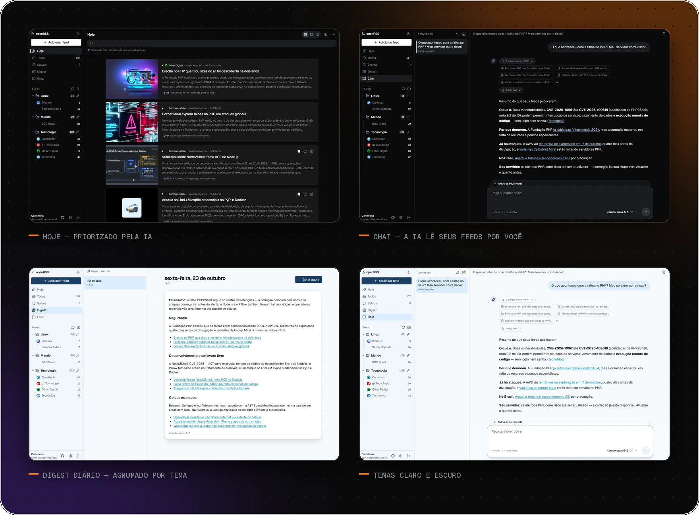
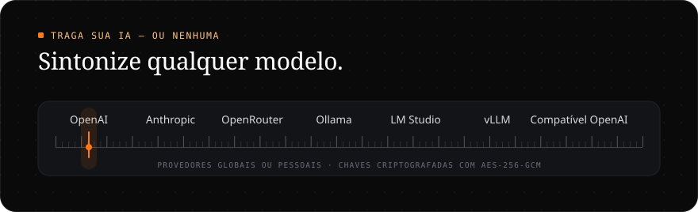

<div align="center">



<br>

<sub>[English](README.md) · **Português** · [Español](README.es.md)</sub>

<br>

<a href="https://github.com/CariSoftwareBR/openRSS/actions/workflows/ci.yml"></a>
<a href="LICENSE"></a>
<a href="https://github.com/CariSoftwareBR/openRSS/pkgs/container/openrss"></a>
<a href="https://buymeacoffee.com/pcarinhena"></a>

</div>

<br>



<br>
<br>



<br>
<br>



<br>
<br>

<h3 align="center">Um dia nos seus feeds</h3>



<details>
<summary><b>Tudo o que ele faz</b></summary>

<br>

**Leitura** — Hoje (priorizado pela IA), Todos, Salvos, pastas e feeds individuais · cartões, grade ou só títulos · modo artigo completo (Readability) · busca instantânea · notícias repetidas agrupadas como “+N fontes” (ler uma marca as outras) · PWA instalável com leitura offline · atalhos de teclado: <kbd>j</kbd> <kbd>k</kbd> navegar · <kbd>o</kbd> abrir · <kbd>m</kbd> marcar lido · <kbd>s</kbd> salvar · <kbd>Shift</kbd>+<kbd>A</kbd> marcar todos · <kbd>/</kbd> buscar

**Feeds** — descoberta automática pela URL do site (RSS, Atom, RDF) · atualização em segundo plano com ETag/Last-Modified e backoff · importar e exportar OPML · ler depois pelo botão em Salvos, bookmarklet ou menu Compartilhar do celular · tags · regras automáticas por título, conteúdo, autor, URL ou nota da IA: marcar como lido, salvar, destacar ou avisar via ntfy, Discord, Slack, Telegram ou webhook · saúde dos feeds (com erro, parados, pouco lidos ou ativos demais) com limpeza em lote · retenção configurável

**IA** — resumos em streaming, com cache · perguntas sobre o artigo no leitor · tradução · leitura em voz alta · busca semântica com embeddings · digest diário, sob demanda ou por e-mail · chat que busca e lê seus feeds · nota de prioridade de 0 a 100 baseada nos seus interesses

**Pessoas** — e-mail e senha ou login único OIDC (Authentik, Authelia, Keycloak…) · a primeira conta vira administradora · cadastro aberto ou fechado · senhas de aplicativo para NetNewsWire, Reeder, ReadYou, FluentReader, Unread… via APIs Google Reader e Fever · temas claro e escuro ([design system](docs/design/))

**Roda em** — um container · SQLite (até ~5 usuários simultâneos) ou PostgreSQL · Next.js 16, React 19, Prisma 7, Better Auth e AI SDK 7

</details>

<br>
<br>

<h3 align="center">Instale com uma frase</h3>



```text
Instale o openRSS: https://github.com/CariSoftwareBR/openRSS
```

<sub>**Agentes de IA:** sigam o [INSTALL.md](INSTALL.md#install) exatamente, do início ao fim. Usem Docker com SQLite, a menos que o usuário peça PostgreSQL, e passem o navegador ao usuário só para criar a conta de administrador.</sub>

<details>
<summary><b>Prefere digitar?</b> Três comandos com Docker</summary>

<br>

```bash
git clone https://github.com/CariSoftwareBR/openRSS.git && cd openRSS
docker compose up -d --build
docker compose logs openrss | grep -i token   # token de instalação para a primeira visita
```

Abra **http://localhost:8285/setup**, cole o token, escolha **SQLite** e crie sua conta de administrador. PostgreSQL, imagem pronta no GHCR, configuração e solução de problemas estão no [guia de instalação](INSTALL.md) (em inglês).

</details>

<br>



<br>
<br>

<div align="center">

**Adicione um feed. Leia o que importa. O resto pode esperar.**

<sub>[Guia de instalação](INSTALL.md) · [Configuração](INSTALL.md#configuration) · [Desenvolvimento](docs/DEVELOPMENT.md) · [Design system](docs/design/) · [Segurança](SECURITY.md) · [Apache 2.0](LICENSE) · Feito por [CariSoftwareBR](https://github.com/CariSoftwareBR)</sub>

</div>
